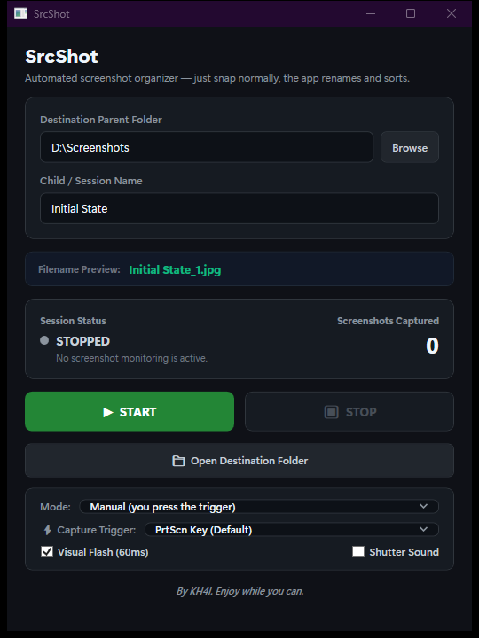
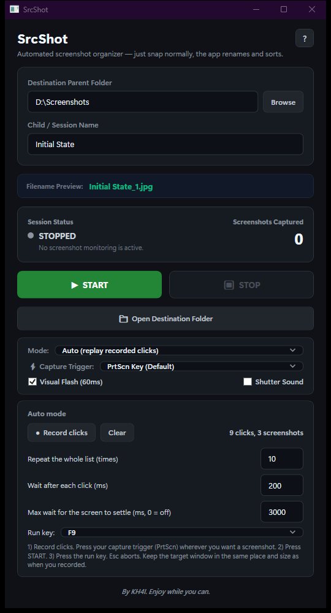
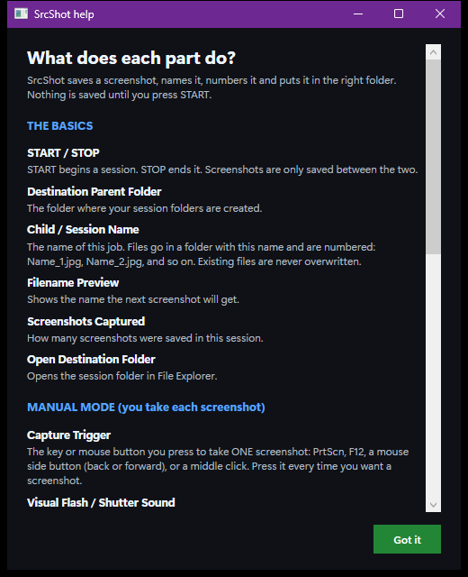

# SrcShot

A tiny Windows tool that takes a screenshot, names it, numbers it and files it into the right folder. One key press, done. Built because I was doing that by hand a hundred times a day.

> Showcase repo: notes and a screenshot only. The source code is private.

## Why I made it

Some jobs need a pile of screenshots as proof, like test and commissioning reports. The manual loop is: take a screenshot, open an editor, save it, name it, move it to the right folder. Repeat 100 times. I got tired of that, so SrcShot does the whole loop for me.

## What it does

- **Instant capture.** Press a trigger and the screen is grabbed and saved in the background, with no lag in the app you are using.
- **Tiny flash for feedback.** A quick, see-through flash tells you the shot worked. It never steals focus, so your click lands where you meant it to.
- **Pick your trigger:** `PrtScn`, `F12`, a mouse side button (back or forward), or a middle click. One-handed capture while you click around.
- **Small files.** Saves high quality JPG (about 150 to 300 KB per full HD shot instead of 3 MB or more for PNG).
- **Smart numbering.** Files become `Initial State_1.jpg`, `Initial State_2.jpg` and so on. It looks at what is already in the folder, carries on from the highest number, and never overwrites anything.
- **Session folders.** Name the session and it creates the folder for you.
- **Auto mode.** Record your clicks once, then replay them with a single key. SrcShot clicks, waits for the screen to settle, and takes the shot for you, over and over (see below).
- **100% local.** No cloud, no accounts, no telemetry.

## How I use it

1. Pick a parent folder and type a session name.
2. Choose a trigger and press **Start**.
3. Click through whatever you are documenting and tap the trigger each time.
4. Press **Stop**, then open the folder. Everything is already named and numbered.

## Auto mode

Some jobs mean clicking through the same list of screens again and again. Auto mode does that part for me.

1. Press **Record clicks** and click through the screens in your usual order. SrcShot remembers each position.
2. Press the capture trigger (PrtScn) wherever you want a screenshot, for example once a deep menu has opened the screen you need. Clicks before that mark just open menus and are not screenshotted.
3. Press **START**, then the run key (F9 by default).
4. It replays the clicks and takes a full-screen screenshot at each mark, once the screen has stopped changing. **Repeat** runs the whole list again and again.
5. **Esc** stops it at any moment.

Instead of a fixed delay, it compares the screen every 100 ms and only shoots once the picture is still, so slow pages get time and fast pages do not wait. Manual mode still works exactly as before.

## Built-in help

Not sure what a button does? Press the **?** at the top, or hover over any control. A plain-language help window explains every one of them.

## Built with

- C# and .NET 8, WPF desktop app (Windows x64)
- Win32 screen capture and low-level keyboard and mouse hooks (with a short debounce so one press is one shot)
- Async JPG encoding, so the UI stays smooth
- Unit and stress tests for the file naming, numbering, capture and Auto mode replay logic

## Design notes

- Global keyboard and mouse hooks fire fast, so a short debounce (250 ms) turns one physical press into exactly one screenshot.
- Numbering starts from the highest file already in the folder, so existing captures are never overwritten.
- It is built to stay out of the way: no focus stealing, no popups, no waiting.

Made by **KH4I**
